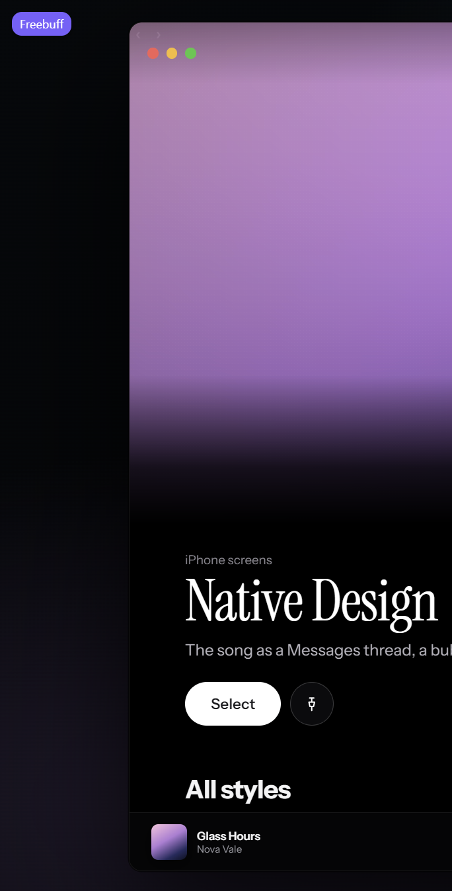
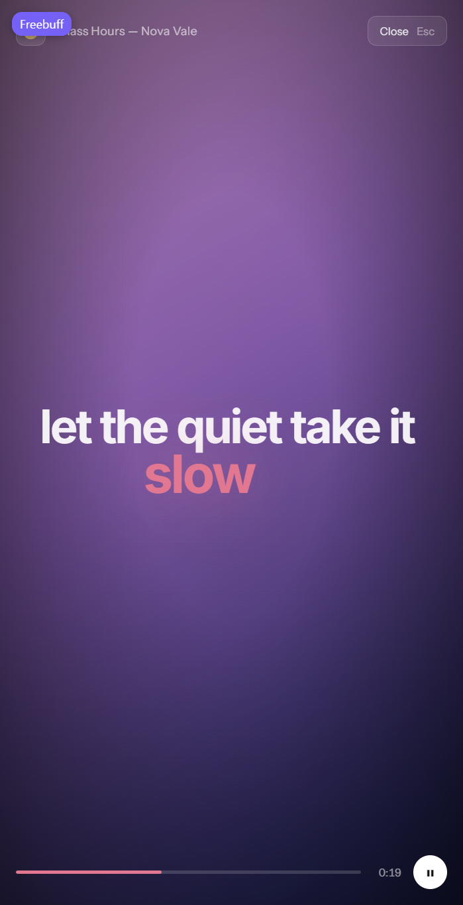

# Verci — live lyrics for whatever you're playing

A desktop lyric window for Windows. It reads the **Windows media session** (Spotify, Apple Music, a browser tab, VLC — anything that publishes to the system media controls), fetches synced lyrics, and performs them word by word in 13 typographic styles.

No accounts, no API keys, no bundled songs. If nothing is playing, it says so.



## What it does

- **Live-only.** No stock tracks. The stage waits for real playback and follows the source app's position.
- **Spotify Connect aware.** When playback is controlled from another device, the desktop Spotify client still publishes the track and position to Windows, so the lyrics follow it too.
- **Synced lyrics** from [LRCLIB](https://lrclib.net) (exact match, then fuzzy search), with a [lyrics.ovh](https://lyrics.ovh) fallback. Plain-only lyrics are **auto-timed** and clearly labelled.
- **13 lyric styles** — Ship, Fisheye, Visual, Fisheye Visual, Codestyle, Codestyle Visual, Branches, Web, Constellation, and the iPhone-screen family: Native Design, Money, Map and Notifications.
- **Place-aware 3D map.** In Native Design, an aerial city card appears only when a place name is actually sung (Pitampura, Kashmere Gate, Connaught Place, Hauz Khas…), with a drawn route and a pulsing pin.
- **Dramatic focus.** The active message scales up while the rest blur; the active word zooms and glows, and fullscreen lines snap into focus from a blur.
- **Multilingual.** Interface in English, हिन्दी, Español, Français, Deutsch, Português, 日本語 and العربية. CJK/Thai lyrics are segmented into words with `Intl.Segmenter`, Arabic/Hebrew lines render RTL, and the emoji/mood layer covers common words in several languages.



## How it works

```
Windows media session (WinRT)
        │  PowerShell loop, JSON lines
        ▼
Electron main  ──►  LRCLIB / lyrics.ovh  ──►  LRC parser
        │  IPC (preload)                        │
        ▼                                       ▼
Renderer: word timing, 13 styles, map, fullscreen
```

- `electron/nowplaying.ps1` polls `GlobalSystemMediaTransportControlsSessionManager`, emitting title, artist, album, position, duration, playback state and source app.
- `electron/main.js` keeps the latest snapshot, fetches lyrics (LRCLIB exact → LRCLIB search → lyrics.ovh) and exposes both over IPC.
- `src/main.js` parses LRC, distributes word timings, and drives the lyric UI from the player's real position.

## Run it

```bash
npm install
npm run dev        # browser preview (no media access)
npm run desktop    # Electron app
npm run dist:win   # NSIS installer in release/
```

## Download

Windows 10/11 x64: [download the installer](https://github.com/aadithere/lyrci/releases/download/v1.2.0/Verci-Setup-1.2.0.exe) (per-user install with Start-menu and desktop shortcuts) or the [portable app](https://github.com/aadithere/lyrci/releases/download/v1.2.0/Verci-1.2.0.exe). See the [latest release](https://github.com/aadithere/lyrci/releases/latest) for updates.

## Limitations

- Media detection is Windows-only; the browser preview shows the waiting state.
- Lyrics coverage depends on LRCLIB/lyrics.ovh. There is no AI lyric generation — when neither provider has a match, the app says so.
- Spotify Connect needs the desktop Spotify client running to publish the session.
- Builds are unsigned, so SmartScreen may warn.
- A design homage to [Verci](https://www.verci.xyz/); not affiliated with Verci, Spotify or Apple. Map imagery is generated, not Apple Maps.
